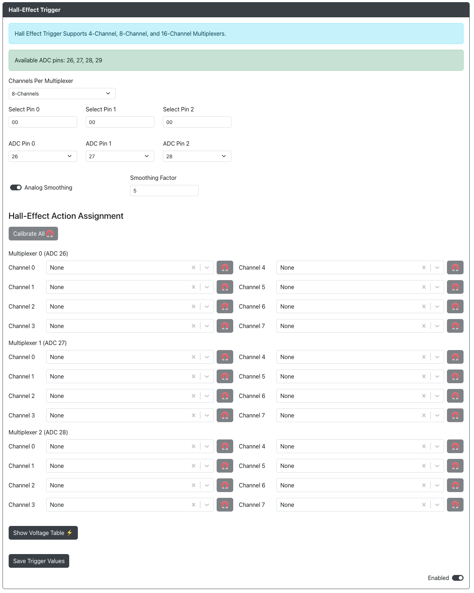
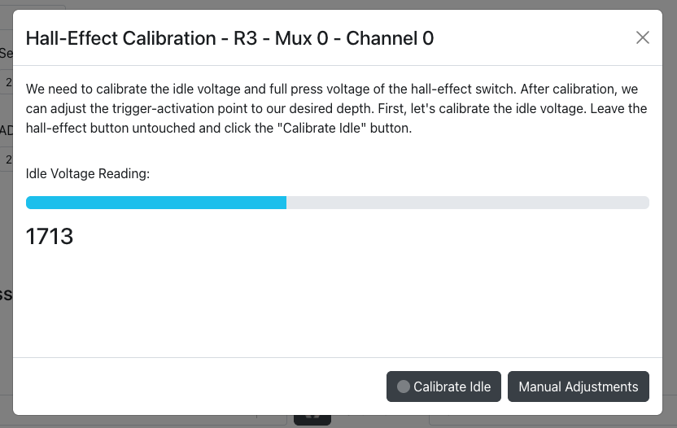
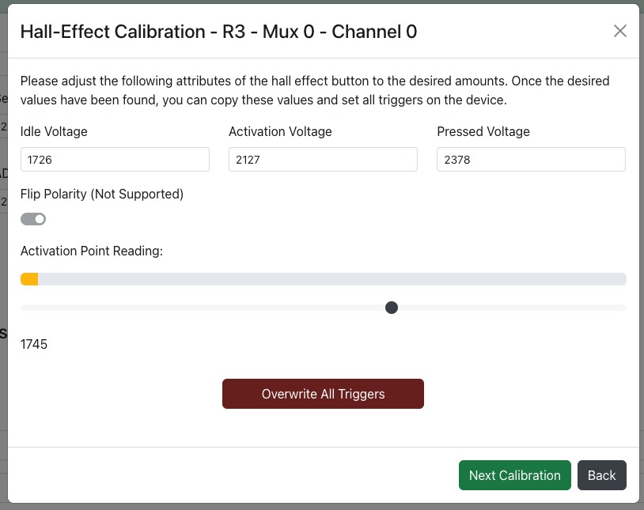
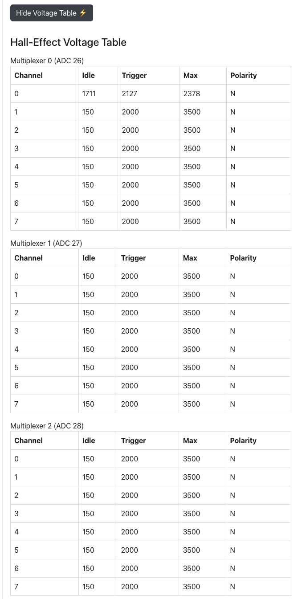

# 霍尔效应按键

用途：此插件用于单独使用霍尔效应按键，或通过多路复用器扩展板使用霍尔效应按键。

## 网页配置器选项

- `每个多路复用器的通道数` - 多路复用器的通道数量。请注意，如果使用多个多路复用器，它们的通道数必须相同。如果不使用多路复用器而是直接连接，请选择 `直连（无多路复用器）`。
- `选择引脚 0` - 多路复用器选择引脚所使用的 GPIO 引脚。
- `选择引脚 1` - 多路复用器选择引脚所使用的 GPIO 引脚。
- `选择引脚 2` - 多路复用器选择引脚所使用的 GPIO 引脚。
- `选择引脚 3` - 多路复用器选择引脚所使用的 GPIO 引脚。
- `ADC 引脚 0` - 第一个多路复用器或单个霍尔效应轴体所使用的 ADC GPIO 引脚。
- `ADC 引脚 1` - 第二个多路复用器或单个霍尔效应轴体所使用的 ADC GPIO 引脚。
- `ADC 引脚 2` - 第三个多路复用器或单个霍尔效应轴体所使用的 ADC GPIO 引脚。
- `ADC 引脚 3` - 第四个多路复用器或单个霍尔效应轴体所使用的 ADC GPIO 引脚。
- `模拟平滑` - 启用模拟平滑，如果读数存在噪声，此选项可能会有帮助。
- `平滑系数` - 介于 1 到 99 之间的 EMA（指数移动平均）值。值为 1 时平滑程度最高，值为 99 时平滑程度最低。

## 校准

### 如何校准霍尔效应轴体

所有已连接的霍尔效应轴体都需要校准，可以逐个校准，也可以一次性全部校准。在大多数情况下，建议同时校准所有霍尔效应按键，除非您使用了不同类型的霍尔效应轴体。

1 - 点击 `全部校准` 按钮，或点击任意一个多路复用器通道对应的磁铁按钮。
2 - 在不按下按键的情况下，等待 `空闲电压读数` 稳定。
3 - 点击 `校准空闲` 按钮。
4 - 将霍尔效应轴体完全按下，在保持轴体完全按下的同时，点击 `校准按下` 按钮。

也可以点击 `手动调整` 按钮，手动进行高级校准。

在高级校准中可以使用以下选项：
- `空闲电压` - 轴体处于空闲状态时的电压。
- `触发电压` - 轴体处于您希望设置的触发点时的电压。
- `按下电压` - 轴体处于最大按下值时的电压。
- `翻转极性` - 暂不支持。

`触发点读数` 部分会在您按下霍尔效应轴体时实时显示其状态。

如果您处于 `全部校准` 界面，将会看到一个 `覆盖所有按键` 按钮，用于覆盖所有之前保存的设置。

## 霍尔效应电压表

霍尔效应电压表会汇总显示您的霍尔效应轴体当前的所有设置。

:::note

在网页配置器中切换到其他页面或重启进入控制器模式之前，请务必点击 `保存按键数值`，否则您的更改将不会被保存。

:::
