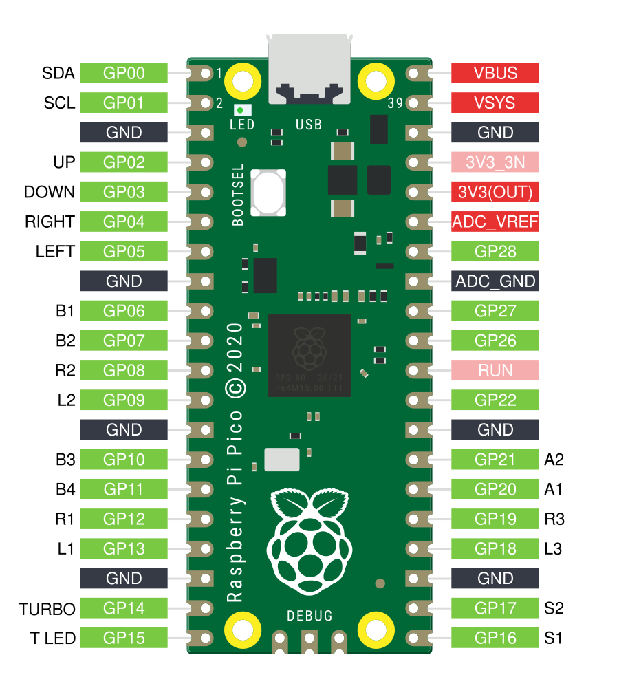
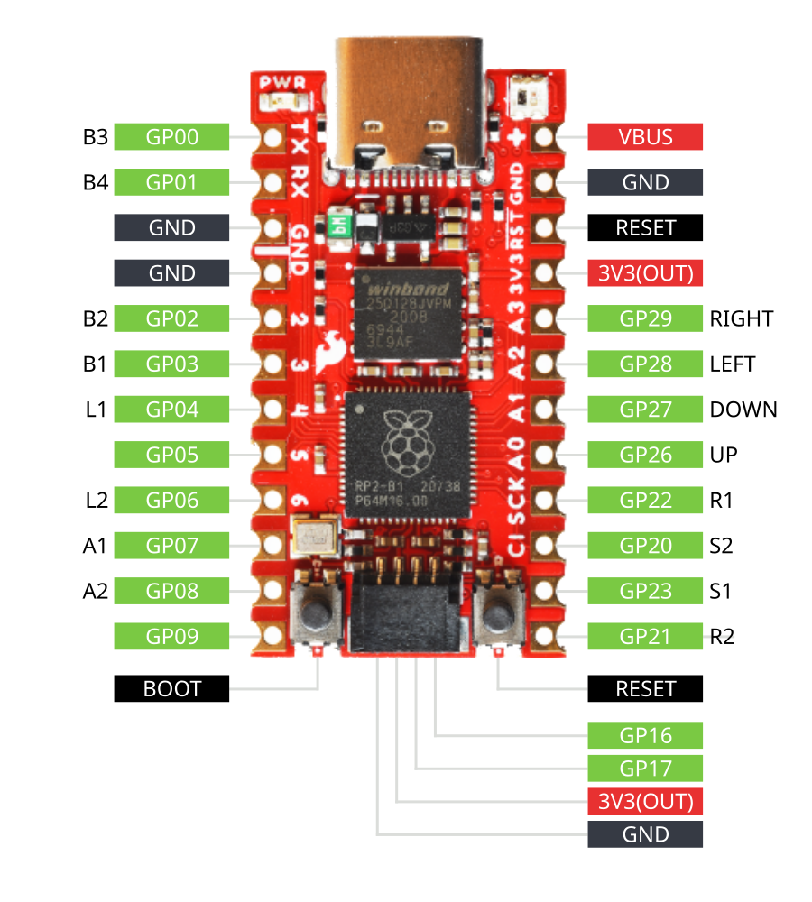
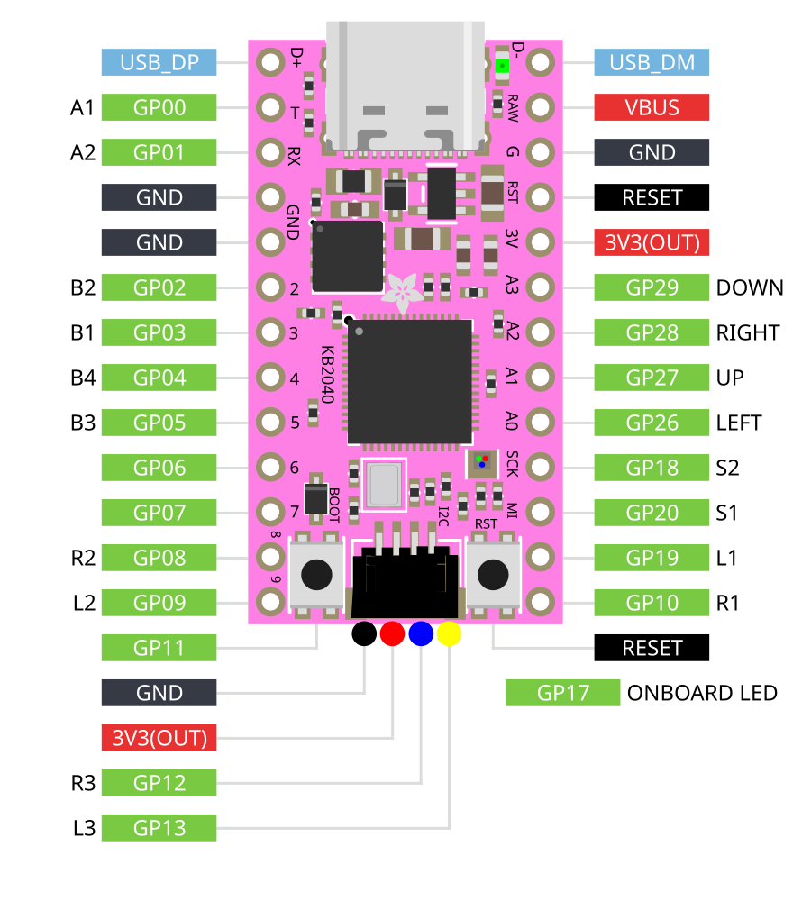
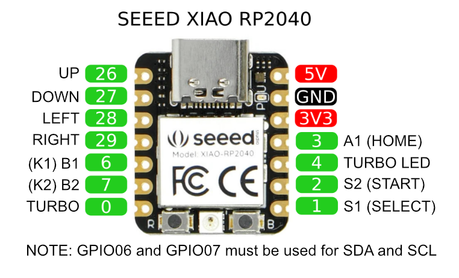
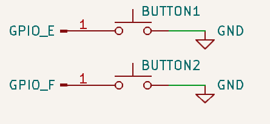
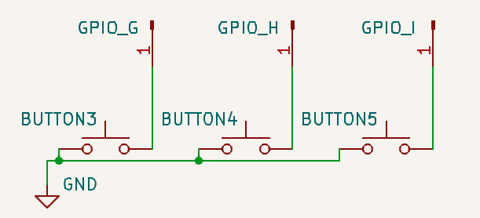
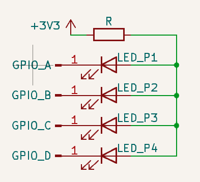

# 接线指南

:::caution

使用这些微控制器板的自定义构建可能会由于供应商不同而具有与下文列出内容不同的 GPIO 引脚映射。  
通过网页配置器重置可能导致 GPIO 引脚映射错误，建议您先与供应商沟通。

:::

以下是 GP2040-CE 支持的微控制器板的引脚分布图，这些板已预编译并可通过 [下载](/downloads) 获取。

这些引脚分布图并不涵盖所有情况，您的 RP2040 板可能具有不同的引脚分布，具体取决于板制造商的设计。请务必谨慎，不要假设您的板上的引脚与下文列出的引脚一致。

:::note 重新配置 GPIO 引脚分布

这些引脚分布并非固定不变。您可以通过 [网页配置器 - GPIO 引脚映射](../web-configurator/menu-pages/02-gpio-pin-mapping.mdx) 根据需要更改引脚分布。

:::

## 树莓派 Pico

:::info 替代的 Pico 板及其克隆版本

树莓派 Pico 的引脚分布同样适用于具有相同外形和引脚分布的克隆板，例如 Pimironi Pico LiPo 和 Waveshare RP2040-Plus。

:::

## SparkFun Pro Micro - RP2040

## Waveshare RP2040-Zero

## Adafruit KB2040

## Seeed XIAO RP2040

# 按键

GP2040-CE 会将输入 GPIO 引脚配置为上拉模式，当按键按下时，引脚应被短接到地（GND）。

您可以为每个按键使用两根导线进行连接（一根接 GPIO 引脚，另一根接地）：

也可以将地线在按键之间串联，例如将两根导线同时压接到一个 FASTON 端子上，或将两根导线焊接到同一个按键引脚上。每个按键的另一个触点必须连接到各自独立的 GPIO 引脚：

# PWM LED

PWM 玩家 LED 引脚的配置方式类似：引脚在激活时短接到地，其他时候则被上拉。这意味着 LED 的阳极必须连接到微控制器的 +3.3V 输出，而每个阴极分别连接到对应的 GPIO 引脚，这种连接方式称为共阳极。电路中必须串入限流电阻以保护 GPIO 引脚；如不确定阻值，可使用在线计算器进行计算。最大安全电流约为 20mA。

